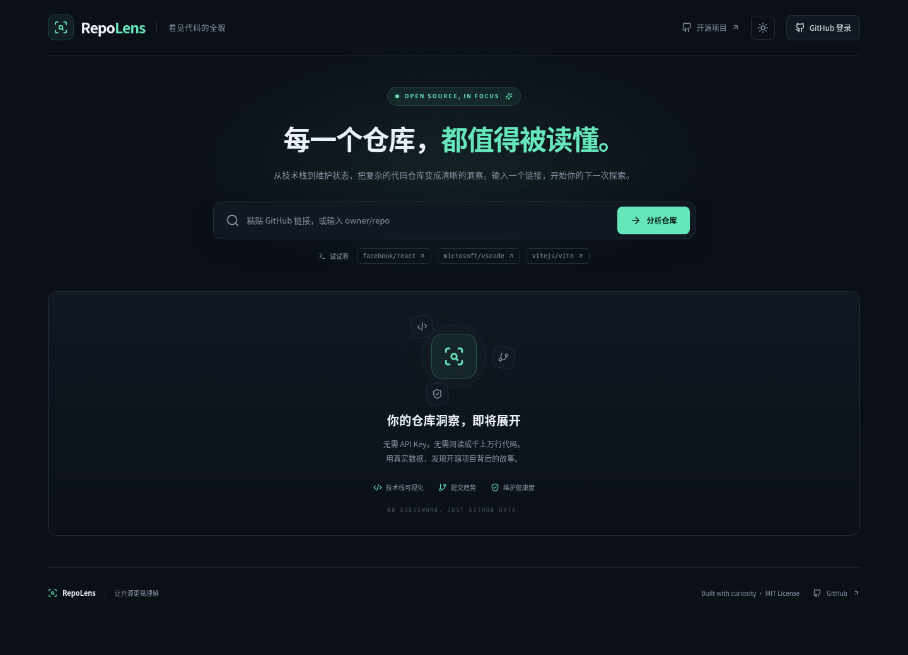
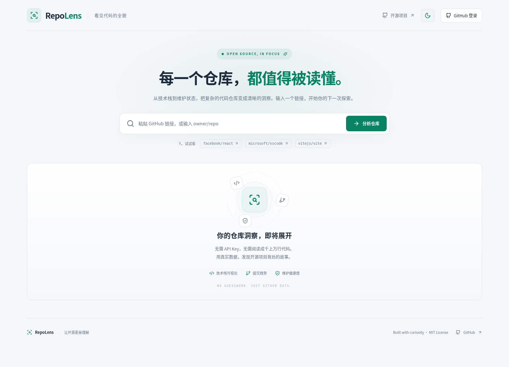

# ◉ RepoLens · GitHub 仓库可视化分析器

**看见代码的全貌。Understand a repository before reading thousands of lines of code.**

RepoLens 是面向开发者、初学者和维护者的开源仓库分析工具。输入公开 GitHub 仓库链接或 `owner/repo`，查看技术栈、代码活动、文档与维护情况。所有仓库信息与图表来自 GitHub REST API；健康度是透明、自定义的参考指标。

RepoLens turns GitHub repositories into readable dashboards of languages, activity, documentation and maintenance signals. Repository facts come from the GitHub REST API. Its health score is a transparent heuristic, not an official GitHub rating.

## 界面 / Screenshots

实际运行的首页截图（不包含虚构仓库报告）。这些截图由项目浏览器生成。
Actual running home screens, without fabricated repository reports.



<details>
<summary>浅色主题 / Light theme</summary>



</details>

## 功能 / Features

- GitHub URL、`owner/repo`、末尾斜杠与 `.git` 后缀解析 / Flexible repository input.
- 简介、所有者头像、Stars、Forks、真实订阅 Watchers、未关闭 Issues + PRs、日期、许可证、分支和主页 / Repository metadata and statistics.
- 语言字节比例环形图、近 12 周默认分支提交曲线与数据表 / Language composition and weekly activity.
- 0–100 健康度，显示各项权重、数据覆盖率和缺失信息 / Explainable health score with missing-data handling.
- GFM Markdown、代码高亮、相对链接处理；忽略原始 HTML、脚本及危险链接 / Safe README rendering.
- 最近 10 个公开仓库历史、删除/清空、10 分钟公开报告缓存 / Local history and public cache.
- 可下载 PNG，含基本信息、语言、健康度、分析时间 / Compact PNG report export.
- 默认深色、浅色切换、移动布局、适度动画、骨架屏与限流/网络/空数据提示 / Themes, responsive UI and explicit request states.
- **可选 GitHub OAuth 登录**：列出账号有权限的个人/组织仓库，分析私有仓库；仅在配置登录服务的 Vercel 部署可用 / Optional authenticated private repository analysis on Vercel.

## 快速开始 / Local development

需要 **Node.js 24 LTS**（也支持 ≥22.12 的 Node.js 22）；浏览器需支持现代 ES2022、Canvas 和 localStorage。无需 GitHub API Key，公开分析无需后端。
Use Node.js 24 LTS (Node.js 22 ≥22.12 also supported). Public analysis needs neither a backend nor an API key.

```sh
git clone https://github.com/fqxxzyw/RepoLens.git
cd RepoLens
npm install
npm run dev
```

Vite 会在终端输出开发地址。`npm install` 用于普通安装；CI 使用锁定依赖的 `npm ci`。
Vite prints the development address. CI uses the committed lockfile with `npm ci`.

```sh
npm run lint
npm test
npm run build
npm run preview
```

浏览器回归检查（测试使用明确标注的固定数据，生产代码没有模拟数据）：
Browser regression tests use labeled fixtures, never production fallback data:

```sh
npx playwright install chromium
npm run test:e2e
```

检查主题、手机溢出、真实渲染的 PNG 下载、Markdown XSS 过滤、快速切换请求、私有报告不落盘、`202`/`404`/限流和历史管理。生成输出在被忽略的 `test-results/`。浏览器测试不证明真实 GitHub 或 OAuth 联调成功。
These checks cover themes, mobile overflow, PNG downloads, Markdown filtering, request races, private storage isolation, API states and history. They do not establish live GitHub or OAuth connectivity.

## 配置 / Configuration

复制 `.env.example` 为 `.env.local` 按需配置；不需要修改任何变量即可公开分析。**`VITE_*` 会打包进前端，不得放入任何私人 Token 或客户端密钥。**
Copy `.env.example` to `.env.local` only if needed. `VITE_*` values are public build-time settings; never put secrets in them.

| 配置 / Variable       | 默认 / Default           | 用途 / Purpose                                                      |
| --------------------- | ------------------------ | ------------------------------------------------------------------- |
| `VITE_GITHUB_API_URL` | `https://api.github.com` | 公开 REST API 源；生产默认官方地址 / Public API origin              |
| `VITE_BASE_PATH`      | `/`                      | Vite 部署路径；Pages 项目站点为 `/RepoLens/` / Asset base path      |
| `VITE_ENABLE_AUTH`    | `false`                  | 在配置服务端的 Vercel 构建设为 `true` / Enable OAuth UI integration |

如使用自定义 API 源，需自行核对 CORS、信任边界和 `vercel.json` 的 CSP `connect-src`。默认安全策略允许官方 API。
If overriding the API origin, review CORS, trust and Vercel CSP; the default policy permits the official API.

## 目录 / Structure

```text
RepoLens/
├── src/
│   ├── components/       # 搜索、概览、图表、评分、README、历史、账号、导出
│   ├── hooks/            # 分析状态、取消请求、缓存与历史
│   ├── lib/              # URL、转换、评分、存储、PNG
│   ├── services/         # 独立 GitHub API 客户端
│   ├── App.tsx           # 页面组合
│   ├── types.ts          # 严格类型
│   └── styles.css        # 主题与响应式
├── api/                  # 可选 Vercel OAuth 与只读 API 代理
├── server/               # 服务端会话加密、Cookie 与代理校验
├── tests/                # 单元、安全与浏览器测试
├── docs/                 # 实际截图与验证记录
├── .github/workflows/    # 检查与 GitHub Pages 自动部署
├── .env.example
├── vercel.json
├── tailwind.config.js
└── LICENSE
```

## GitHub Pages 部署 / Deployment

GitHub Pages 版本是纯前端，**支持任意公开仓库，不提供私有仓库登录服务**。
GitHub Pages hosts the public analyzer; server-side OAuth is unavailable there.

1. 将项目提交到仓库的 `main` 分支 / Push the project to `main`.
2. 打开仓库 **Settings → Pages → Build and deployment → Source: GitHub Actions**.
3. `.github/workflows/pages.yml` 自动执行依赖安装、Lint、单元/浏览器测试、构建、部署。Pull Request 仅检查，不部署。
4. 项目站点基路径由工作流设为 `/<repository-name>/`；如使用 `owner.github.io` 根站点或自定义域名，改为 `/`。

Enable GitHub Actions as the Pages source. Pushes to `main` build and deploy; pull requests validate only. Change the workflow base path to `/` for a user site or root custom domain.

## Vercel 与可选个人登录 / Optional GitHub login

公开分析：导入仓库到 Vercel，Framework 选择 Vite，构建 `npm run build`，输出 `dist`，保持 `VITE_ENABLE_AUTH=false` 即可。
For public analysis, import as a Vite project, build with `npm run build`, output `dist`, and leave authentication disabled.

私有仓库需要 GitHub OAuth 授权。授权码交换必须在服务端进行；GitHub Pages 无法安全保存 OAuth Client Secret。本项目提供两条小型 Vercel Serverless Functions，普通访客仍可免登录分析公开仓库。
Private repository access requires OAuth. The code exchange happens in two optional Vercel functions; no client secret or GitHub access token is bundled into the frontend.

1. 在 GitHub **Settings → Developer settings → OAuth Apps** 创建应用。
2. Homepage URL 设为固定 HTTPS 域名，例如 `https://your-domain`；Authorization callback URL 精确设为 `https://your-domain/api/auth?action=callback`。
3. 在 Vercel 项目的安全环境变量中配置：

   | 服务端变量 / Server variable | 内容 / Value                                             |
   | ---------------------------- | -------------------------------------------------------- |
   | `GITHUB_CLIENT_ID`           | OAuth App Client ID                                      |
   | `GITHUB_CLIENT_SECRET`       | OAuth App Client Secret，绝不加 `VITE_` 前缀             |
   | `SESSION_SECRET`             | 至少 32 字符的随机密钥，可用 `openssl rand -hex 32` 生成 |
   | `APP_URL`                    | 固定部署源，如 `https://your-domain`，不含路径           |

4. 设置前端构建变量 `VITE_ENABLE_AUTH=true`、`VITE_BASE_PATH=/` 并重新部署。
5. 点击 GitHub 登录，完成授权后跳回应用。点击用户名选择个人、协作或组织仓库，也可直接输入有权限的私有仓库地址。
6. 本地完整 OAuth 测试可使用 `npx vercel dev`（默认 3000 端口），单独的开发 OAuth App callback 设为 `http://localhost:3000/api/auth?action=callback`，`APP_URL=http://localhost:3000`。单独 `npm run dev` 不运行 Vercel API。

Create an OAuth App with a fixed callback, add the server-only settings in Vercel, enable auth at build time, and redeploy. Use `vercel dev` with a separate localhost OAuth App for full local auth testing.

**权限与隐私 / Permissions & privacy**

- OAuth 请求 `read:user repo`。GitHub OAuth 的 `repo` scope 对私有仓库是较宽的读写授权，不是只读 scope；请核对 GitHub 授权页后选择是否登录。本应用代理仅允许 GET 分析端点，不实现写入仓库操作。公开分析完全不需要这项授权。
- Access Token 仅保存在 AES-256-GCM 加密且认证的 HttpOnly cookie，生产设置 Secure/SameSite=Lax，8 小时过期；OAuth state 10 分钟过期，回调验证 state 防止登录 CSRF。客户端 JavaScript 无法读取令牌。
- 私有报告只在内存中使用，不进入 localStorage 缓存或历史；私有 README 图片不自动加载，避免向外部图片站点泄露信息。退出会清除当前报告和本地缓存/历史。导出私有 PNG 是用户明确触发的本地操作，分享前请检查内容。
- 本地退出删除会话，不自动撤销 GitHub OAuth 授权。可在 GitHub **Settings → Applications → Authorized OAuth Apps** 中撤销授权。轮换 `SESSION_SECRET` 会让所有现有会话失效。
- 组织访问可能需要管理员批准或 SSO 授权。登录成功不保证可访问全部组织仓库。

The OAuth `repo` scope includes broad write permission on GitHub, although this application exposes only read-only analysis endpoints. Tokens are encrypted in HttpOnly cookies; private reports never enter persistent browser storage. Sign out removes the session, not the GitHub grant; revoke the app in GitHub settings when needed. Organization approval/SSO may apply.

## API 数据边界与限流 / Limits and data semantics

- 未认证 REST 请求通常为 **60 次/小时/IP**；认证请求通常为 **5000 次/小时/用户**，GitHub 可调整具体额度。Issue 搜索另有较低限额，二级限流仍可能发生。一次分析会请求仓库、语言、README、提交统计和两个 Issue 搜索统计；提交 `202` 时最多尝试 3 次。
- 仓库卡片的 Open Issues + PRs 来自 GitHub `open_issues_count`，包含 PR；评分单独用 `is:issue` 搜索计数排除 PR。Watchers 使用 `subscribers_count`，不把 Stars 当作 Watchers。
- 语言组成是 GitHub 的代码字节统计，**不是代码行数**；提交统计基于默认分支，由 GitHub 异步计算。`202` 显示等待提示；空仓库、权限不足、大型仓库不支持或限流时显示真实不可用状态，允许手动刷新。
- 独立端点失败不隐藏已成功获取的基本信息；网络超时、`401`、`403`、`404`、`429` 有明确提示。切换仓库取消旧请求并检查请求序号，防止覆盖新结果。
- 公开完整报告缓存 10 分钟，显示原分析时间；点击“刷新”绕过缓存。存在错误/缺失状态的报告不缓存。Storage 被禁用时仍能分析。
- README 忽略原始 HTML，不运行脚本，仅允许 HTTP(S) 链接，外链使用 `noopener noreferrer`，图片禁止传递 Referer；超过 500 KB 的 README 降级为 GitHub 链接。Markdown 内容本身仍是仓库作者提供的信息。
- PNG 导出是紧凑报告，不包含长 README，避免移动端 Canvas 内存溢出；导出包括仓库统计、语言比例、健康度细项与原分析时间。

Unauthenticated REST access is typically 60 requests/hour/IP; authenticated access is typically 5,000/hour/user. Search and secondary limits differ. Activity is asynchronous and may be unavailable. Missing data remains explicitly missing; no fake graphs are shown. README HTML is ignored and links are filtered. PNG exports a compact report instead of the entire README.

GitHub 文档 / Official references: [REST rate limits](https://docs.github.com/en/rest/using-the-rest-api/rate-limits-for-the-rest-api), [repository statistics](https://docs.github.com/en/rest/metrics/statistics), [OAuth scopes](https://docs.github.com/en/apps/oauth-apps/building-oauth-apps/scopes-for-oauth-apps).

## 健康度规则 / Health methodology

| 维度 / Signal              | 权重 / Weight | 评分 / Scoring                                    |
| -------------------------- | ------------- | ------------------------------------------------- |
| 最近代码推送 / Recent push | 25%           | ≤30/90/180/365 天分别 100/80/60/35 分；更旧 10 分 |
| Issue 处理 / Issue closure | 20%           | 已关闭 / 总 Issue × 100；没有 Issue 时排除        |
| README                     | 20%           | 确认存在 100，确认缺失 0；请求失败则未知          |
| License                    | 15%           | API 识别到许可证 100，否则 0                      |
| 持续提交 / Active weeks    | 20%           | 最近最多 12 周中有提交的周比例 × 100              |

未知项排除，最终得分为 `sum(score × weight) / sum(known weight)`，显示有效权重覆盖率。分数并不衡量代码质量、安全性、项目价值或是否适合使用；成熟稳定项目也可能长期没有提交。
Unknown signals are excluded and known weights renormalized. Coverage is displayed. The score does not measure code quality, security, usefulness or suitability; stable mature projects can have few commits.

## 验证状态 / Validation

详见 [docs/VALIDATION.md](docs/VALIDATION.md)，分别记录自动测试、浏览器固定数据验证和真实 API/OAuth 验证边界。不要把固定数据浏览器检查视为线上联调证明。
See the validation report for local checks and the separate boundaries of browser fixtures versus live integration.

## 未来计划 / Roadmap

以下尚未实现 / Not implemented yet:

- 多仓库对比 / Repository comparisons.
- 可配置评分权重与更多语言 / Custom weights and full UI localization.
- GitHub App 细粒度只读授权替代宽泛 OAuth scope / Fine-grained GitHub App authorization.
- 更完整的贡献者、Release 和依赖分析 / Contributors, releases and dependency insights.

## 贡献与协议 / Contributing & License

欢迎提交 Issue 和 PR。流程见 [CONTRIBUTING.md](CONTRIBUTING.md)。请勿提交真实 Token、`.env.local`、个人缓存或私有仓库报告。
Issues and pull requests are welcome. See the contribution guide; never commit credentials or private reports.

MIT License · [LICENSE](LICENSE)
